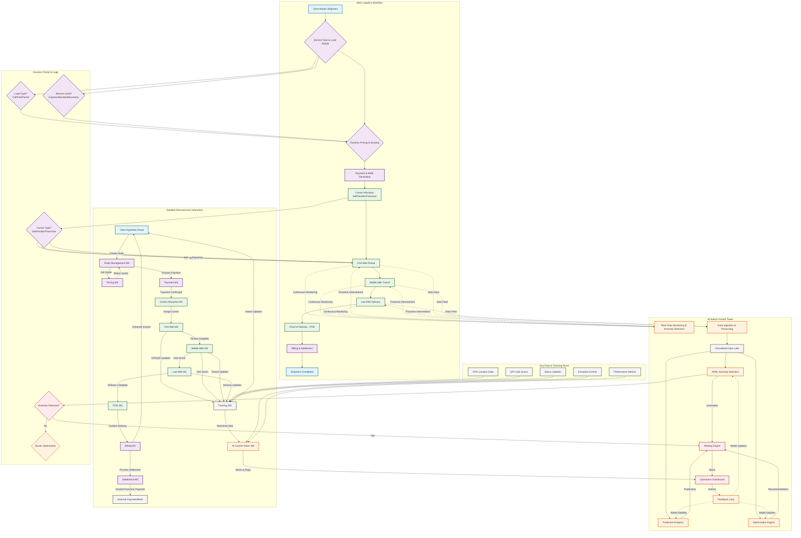
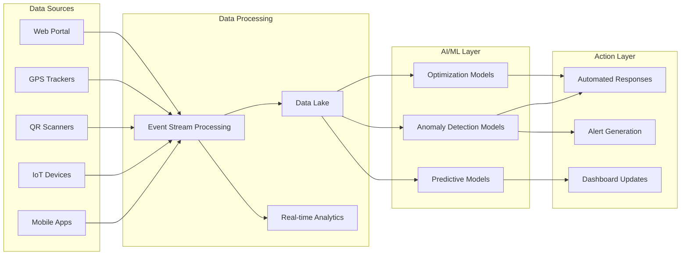
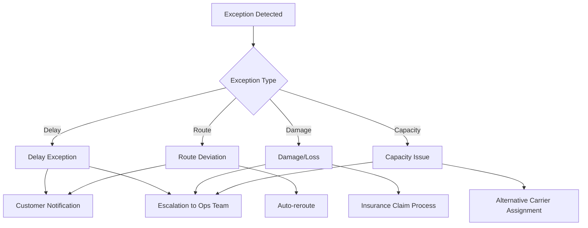

# Logistics Platform Workflow - Detailed Flowchart

## Complete Workflow Diagram

## Workflow Stage Details

### 1. Booking & Order Creation
- Client provides: Load type, dimensions, origin, destination, service type
- System validates input and creates order record
- Real-time pricing calculation based on parameters

### 2. Carrier Allocation
- AI-driven allocation based on:
  - Carrier availability
  - Route optimization
  - Cost efficiency
  - Performance history

### 3. First Mile Operations
- Driver assignment
- Pickup scheduling
- QR code generation for tracking
- GPS tracking activation

### 4. Middle Mile Transit
- Hub operations
- Inter-city transportation
- Load consolidation/deconsolidation
- Transit tracking

### 5. Last Mile Delivery
- Final delivery assignment
- Route optimization
- Customer notifications
- Delivery attempt management

### 6. POD & Billing
- Digital POD capture
- Invoice generation
- Settlement processing
- Vendor/franchise payments

### 7. AI Control Tower Functions
- **Real-time Monitoring**: Continuous tracking of all shipments
- **Anomaly Detection**: ML models identify deviations from expected patterns
- **Predictive Analytics**: Forecast delays, optimize routes
- **Automated Alerts**: Proactive notification system
- **Performance Analytics**: KPI tracking and reporting

## Data Flow Architecture

## Exception Handling Workflow

## Key Integration Points

1. **Client Interface Integration**
   - Web portal API
   - Mobile app API
   - Third-party integrations

2. **Carrier Integration**
   - Self-fleet management system
   - Vendor APIs
   - Franchise partner systems

3. **Payment Integration**
   - Payment gateway
   - Bank APIs
   - Settlement systems

4. **Tracking Integration**
   - GPS providers
   - IoT platforms
   - QR/barcode systems

5. **AI/ML Platform Integration**
   - Model training pipeline
   - Real-time inference
   - Feedback loop processing