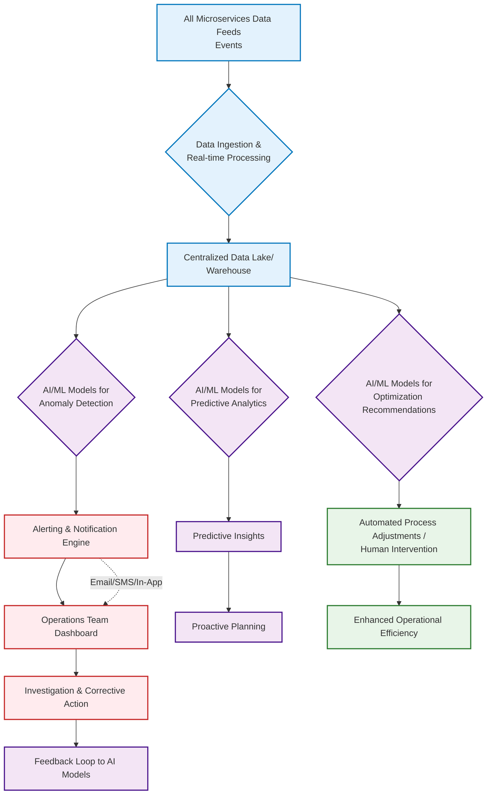
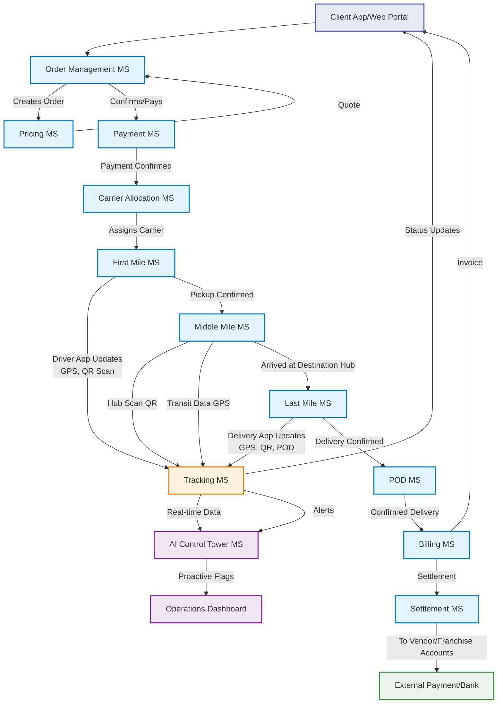
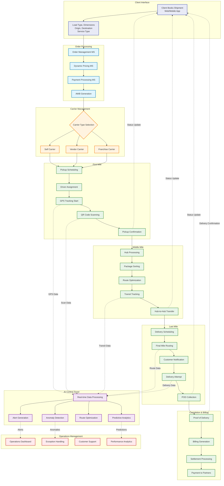
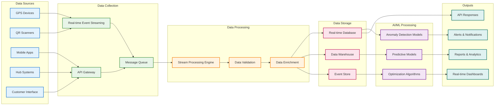

# Logistics Workflow - Detailed Flowcharts

## 1. High-Level Main Workflow

## 2. AI-Native Control Tower Logic & Workflow

## 3. Detailed Microservices Interaction with Tracking

## 4. Comprehensive Integrated Workflow

## 5. Data Flow & Tracking Architecture

## Key Features Highlighted:

### 1. **Multi-Stage Workflow**
- Client booking through completion
- Clear handoffs between stages
- Real-time status updates

### 2. **AI-Native Control Tower**
- Continuous monitoring across all stages
- Anomaly detection and predictive analytics
- Automated alerts and recommendations

### 3. **Microservices Architecture**
- Modular, scalable components
- Clear service boundaries
- Event-driven communication

### 4. **Comprehensive Tracking**
- GPS tracking throughout journey
- QR code scanning at checkpoints
- Real-time data feeds to AI system

### 5. **Multi-Carrier Support**
- Self, vendor, and franchise carriers
- Unified tracking regardless of carrier type
- Consistent service delivery

This flowchart system provides a complete view of your logistics workflow, from initial booking to final settlement, with integrated AI monitoring and optimization throughout the entire process.