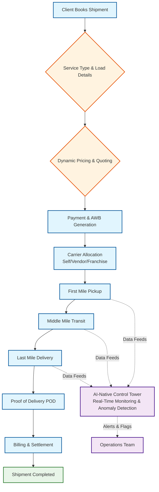
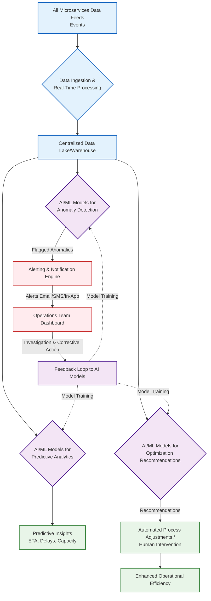
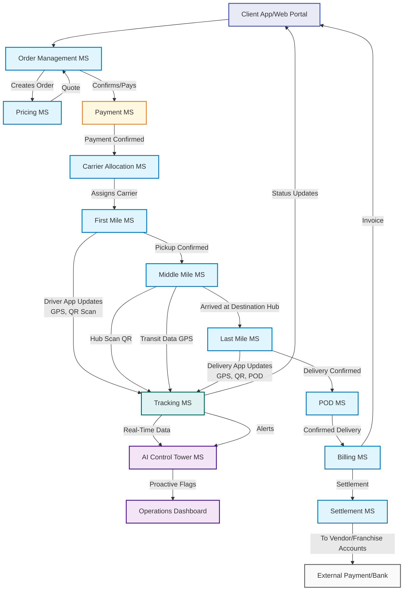
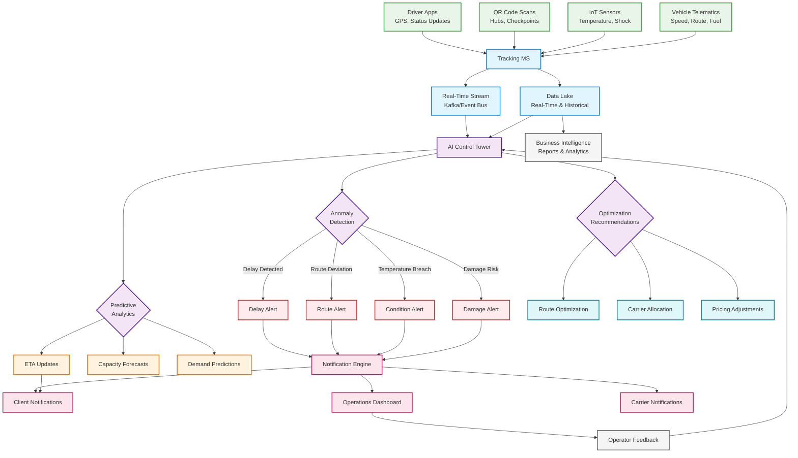
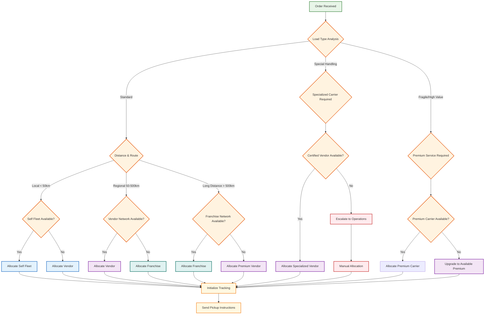
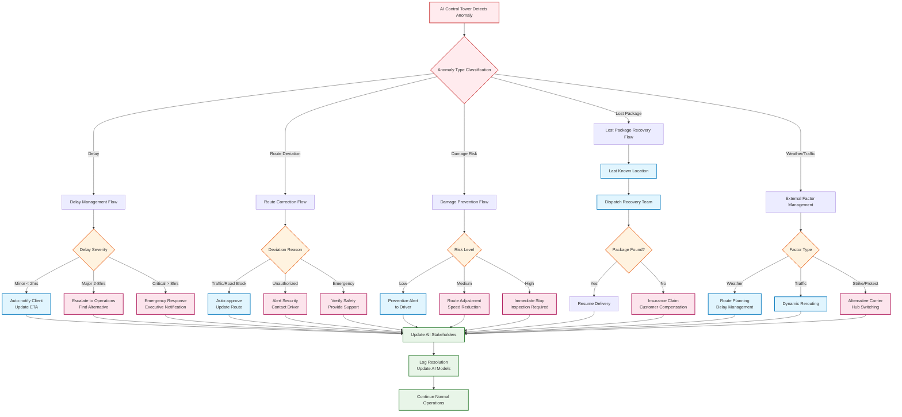
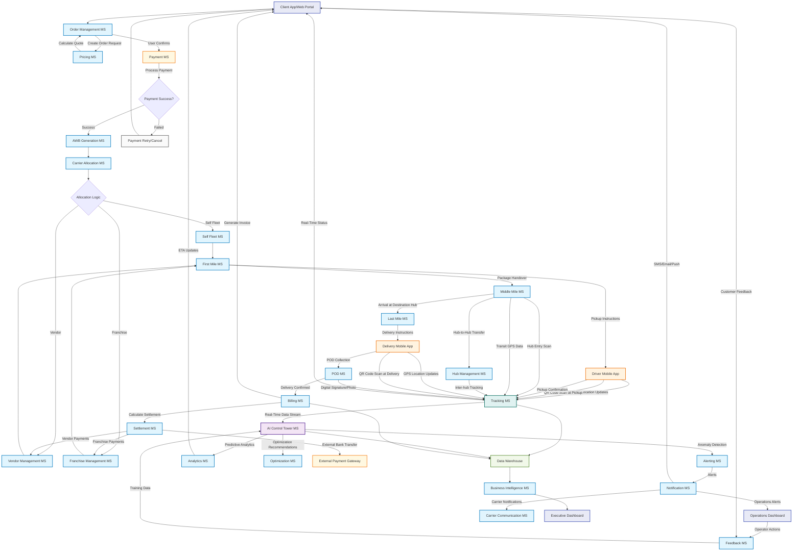
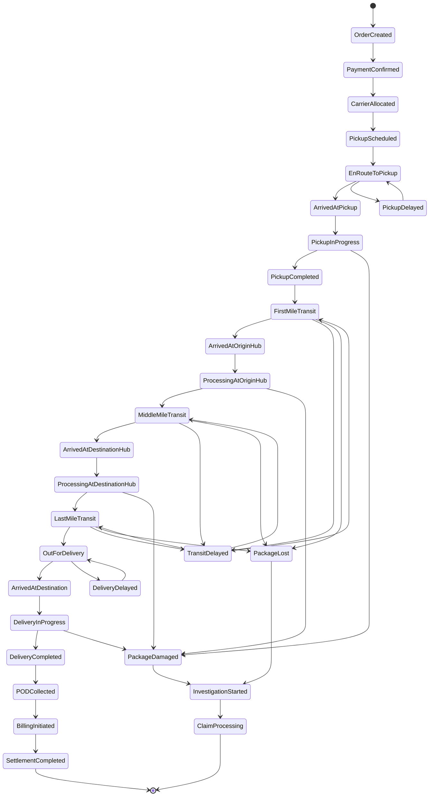
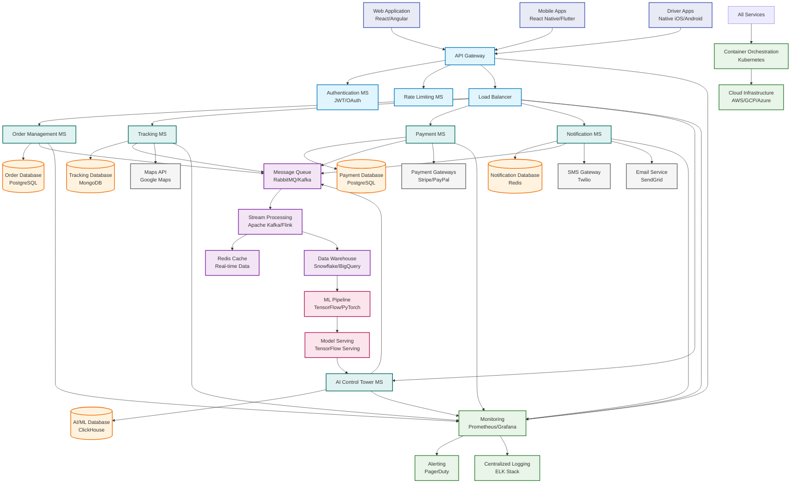
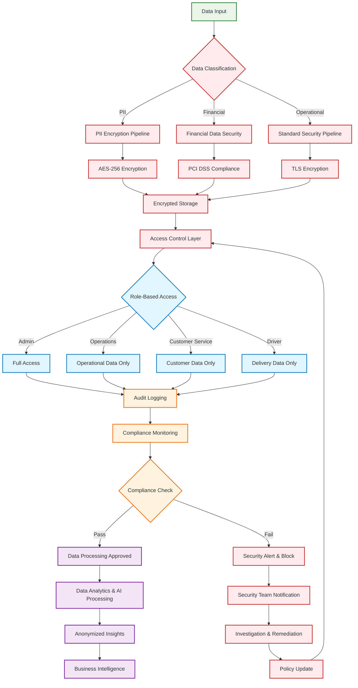

# Detailed Logistics Workflow Flowcharts

## 1. Main High-Level Workflow

## 2. AI-Native Control Tower Logic & Workflow

## 3. Detailed Microservices Interaction with Tracking Mechanisms

## 4. Data Flow & Real-Time Tracking Architecture

## 5. Carrier Allocation Decision Flow

## 6. Exception Handling & Anomaly Response Flow

## 7. Comprehensive Microservices Interaction Flow

## 8. Real-Time Tracking State Machine

## 9. Technology Stack Integration Flow

## 10. Data Security & Compliance Flow

## Key Features of This Workflow System:

### 1. **Real-Time Visibility**
- Continuous GPS tracking from pickup to delivery
- QR code scanning at every checkpoint
- IoT sensor integration for environmental monitoring
- Live status updates to all stakeholders

### 2. **AI-Driven Intelligence**
- Predictive analytics for ETA and potential delays
- Anomaly detection for route deviations, delays, and risks
- Dynamic optimization recommendations
- Automated decision-making for routine operations

### 3. **Multi-Carrier Flexibility**
- Dynamic allocation between self-fleet, vendors, and franchises
- Specialized handling for different cargo types
- Scalable network management
- Performance-based carrier selection

### 4. **Exception Handling**
- Proactive issue detection and resolution
- Escalation procedures for different severity levels
- Automated recovery processes
- Comprehensive audit trails

### 5. **Stakeholder Integration**
- Real-time client notifications and tracking
- Driver/carrier mobile applications
- Operations dashboard for monitoring
- Executive reporting and analytics

This comprehensive workflow ensures end-to-end visibility, proactive issue management, and optimal resource utilization across the entire logistics operation.